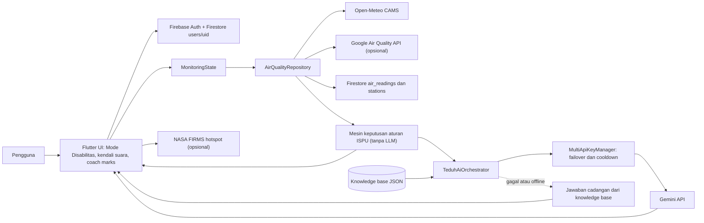

# TEDUH: Tanggap terhadap Emisi dan Dampak Udara bagi Kesehatan

**Hidup Sehat, Udara Sehat**

TEDUH adalah aplikasi mobile (Android, Flutter) berbasis AI yang membantu masyarakat, termasuk penyandang disabilitas, memantau kualitas udara, mengetahui apa yang aman dilakukan, dan bersiap menghadapi kabut asap akibat kebakaran hutan dan lahan (karhutla).

Dibuat oleh tim **ARSR** untuk **LOGICODIX 2026 Hackathon Competition**.

| Tautan | Alamat |
|---|---|
| Unduh dan pasang APK | https://github.com/Rayya-analyst/TEDUH/releases/tag/v1.0.0 |
| Video demo | https://youtu.be/ubgyHvsKrbI |
| Akun demonstrasi | Daftar dengan akun apa saja (lihat bagian [Akun demonstrasi](#akun-demonstrasi)) |

## Tim ARSR

| No | Nama | Peran | GitHub |
|---|---|---|---|
| 1 | Azka Mayyasa Tsurayya Vashty | Ketua, Project Manager, dan AI Engineer | [Rayya-analyst](https://github.com/Rayya-analyst) |
| 2 | Arum Puji Wahyu Intania | UI/UX Designer | [pujiarum661-create](https://github.com/pujiarum661-create) |
| 3 | Rona Qurrotu Aiini | Back End | [rnaacy-jpg](https://github.com/rnaacy-jpg) |
| 4 | Sinta Ayu Cahya Dewi | Front End | [sintaayucahya](https://github.com/sintaayucahya) |

- **Kategori:** Mobile (Android)
- **Subtema:** Inclusive Health & Well-being, dengan irisan Green Environment & Sustainability

## Latar belakang

Kejadian kebakaran hutan dan lahan (karhutla) menjadi salah satu hal yang melatarbelakangi pengembangan TEDUH. Peristiwa tersebut menyebabkan penurunan kualitas udara akibat asap yang menyebar ke lingkungan sekitar dan berpotensi mengganggu aktivitas serta kesehatan masyarakat. Dampak paparan asap menjadi perhatian khusus bagi kelompok rentan, seperti anak-anak, lansia, ibu hamil, dan masyarakat yang memiliki gangguan pernapasan.

Di sisi lain, informasi kualitas udara yang tersedia sering kali disajikan dalam bentuk angka atau grafik yang belum tentu mudah dipahami oleh semua kalangan. Masyarakat tidak hanya membutuhkan informasi mengenai kondisi udara, tetapi juga panduan praktis tentang tindakan yang perlu dilakukan, seperti kapan sebaiknya mengurangi aktivitas di luar ruangan, bagaimana melindungi diri dari paparan asap, dan apa yang perlu dipersiapkan ketika kondisi udara memburuk. Informasi tersebut juga perlu dapat diakses oleh penyandang disabilitas dengan kebutuhan aksesibilitas yang beragam.

Berangkat dari permasalahan tersebut, tim ARSR mengembangkan TEDUH (Hidup Sehat, Udara Sehat), sebuah aplikasi berbasis Android yang membantu masyarakat memahami kondisi kualitas udara dan mengambil langkah perlindungan diri. TEDUH menggabungkan pemantauan kualitas udara, rekomendasi aktivitas berdasarkan tingkat risiko, panduan kesiapsiagaan menghadapi kabut asap, serta asisten berbasis AI untuk membantu menjelaskan informasi dengan bahasa yang lebih mudah dipahami.

TEDUH juga dirancang dengan pendekatan inklusif melalui fitur aksesibilitas, seperti kendali suara, pembacaan informasi, peringatan multisensori, dan penyesuaian tampilan berdasarkan kebutuhan pengguna. Dengan demikian, TEDUH diharapkan dapat menjadi pendamping digital yang membantu masyarakat lebih tanggap, siap, dan peduli terhadap risiko pencemaran udara, sekaligus mendukung terwujudnya kesehatan dan kesejahteraan yang inklusif.

### Masalah yang diangkat

Dari latar belakang itu, kami merumuskan tiga masalah utama:

1. **Informasi yang tidak bisa ditindaklanjuti.** Warga melihat angka ISPU dan grafik, tetapi tidak tahu apakah boleh berangkat sekolah, bekerja di luar, atau berolahraga.
2. **Informasi yang tidak inklusif.** Tunanetra tidak dapat membaca peta dan angka, tunarungu tidak mendengar sirene, dan penyandang disabilitas intelektual kesulitan dengan istilah teknis.
3. **Kesiapsiagaan yang terlambat.** Masker, rencana darurat, dan kontak penting sering baru dicari setelah udara memburuk.

## Solusi

TEDUH menjawab ketiga masalah itu dalam satu aplikasi, dengan tiga pilar dan satu lapisan inklusi:

| Pilar | Pertanyaan yang dijawab | Isi |
|---|---|---|
| **TEDUH NOW** | "Bagaimana udara di sekitarku sekarang?" | Kualitas udara menurut lokasi, peta, riwayat, titik panas satelit, mode offline, peringatan udara berbahaya |
| **TEDUH ACTION** | "Apa yang aman kulakukan?" | Rekomendasi aktivitas indoor atau outdoor otomatis sesuai ISPU, aktivitas, dan kelompok sensitif |
| **TEDUH READY** | "Apakah aku sudah siap?" | Tas siaga, langkah harian, rencana darurat, kontak darurat, persentase kesiapan |
| **Mode Inklusif** | "Bagaimana aku memakainya?" | Aplikasi menyesuaikan diri dengan 7 jenis disabilitas, kendali suara, dan peringatan multi-indra |

### Target pengguna

- Masyarakat di wilayah rawan kabut asap dan polusi udara.
- Kelompok sensitif: anak, lansia, ibu hamil, penderita gangguan pernapasan.
- Penyandang disabilitas: tunanetra, low vision, tunarungu, tunawicara, tunadaksa, disabilitas intelektual, dan disabilitas ganda.

## Fitur yang berhasil diimplementasikan

**Inklusi dan aksesibilitas**
- **Mode Disabilitas adaptif (7 jenis).** Setelah splash, aplikasi menanyakan dengan suara apakah pengguna penyandang disabilitas dan jenisnya, lalu menyesuaikan ukuran teks, kontras, suara, getar, dan panduan.
- **Kendali suara hands-free berbahasa Indonesia** (speech-to-text dan text-to-speech), termasuk masuk dan daftar hanya dengan bicara.
- **Panduan bersorot (coach marks)** di hampir semua halaman.
- **Peringatan udara berbahaya multi-indra:** sirene singkat, penjelasan suara, getar, dan kedip layar untuk pengguna tunarungu.

**Pemantauan dan tindakan**
- Kualitas udara menurut lokasi (GPS atau pilih wilayah), peta, riwayat, dan pilihan sumber data.
- Titik panas (hotspot) satelit NASA FIRMS sebagai petunjuk kebakaran aktif.
- Mode offline untuk panduan kesehatan dan kontak darurat.
- Mesin keputusan berbasis aturan ISPU (Permen LHK No. 14 Tahun 2020) untuk rekomendasi aktivitas.
- Sesi aktivitas indoor dan outdoor dengan pewaktu, poin, dan reward.

**Kesiapsiagaan dan AI**
- TEDUH READY: tas siaga, langkah harian, rencana darurat, dan kontak darurat.
- Asisten AI dan Analisis AI dengan konteks udara pengguna.

**Akun dan privasi**
- Daftar, masuk (email dan Google), ubah kata sandi, kebijakan privasi, dan hapus akun permanen.

## Mengapa TEDUH berbeda

- **Berangkat dari tindakan, bukan angka.** Setiap data udara diterjemahkan menjadi apa yang boleh dan tidak boleh dilakukan.
- **Inklusif sejak rancangan,** bukan fitur tambahan. Tiap jenis disabilitas mendapat penanganan berbeda, misalnya tunarungu mendapat getar dan kedip layar, dan tunawicara tidak pernah dipaksa berbicara.
- **Keselamatan tidak diserahkan ke LLM.** Ambang risiko ditentukan mesin aturan yang deterministik. AI hanya menjelaskan dan menjawab pertanyaan, dan tetap bisa menjawab dari basis pengetahuan lokal saat layanan AI gagal atau tidak ada internet.
- **Jujur tentang data.** Aplikasi menyebut sumber dan sifat datanya (model atau satelit), bukan mengklaimnya sebagai ISPU stasiun resmi.

## Keterbatasan yang kami nyatakan terbuka

- Data kualitas udara berasal dari **model atmosfer** (Open-Meteo/CAMS, dan opsional Google Air Quality API), bukan pengukuran stasiun resmi KLHK. Angka di aplikasi tidak boleh dianggap sebagai ISPU resmi. Karena KLHK masih belum menyediakan sumber API secara publik.
- **Hotspot NASA FIRMS** adalah deteksi anomali panas oleh satelit. Itu menunjukkan kemungkinan kebakaran aktif, bukan konsentrasi PM2.5 atau ISPU.
- Sumber "sensor komunitas IoT" **belum aktif**. Aplikasi menampilkan "data tidak tersedia", bukan data fiktif.
- Jawaban AI bukan pengganti saran medis.
- Diuji pada satu perangkat Android. iOS belum diuji.

## Teknologi

| Lapisan | Yang dipakai |
|---|---|
| Aplikasi | Flutter, Dart, Material, google_fonts |
| Akun dan data pengguna | Firebase Authentication (email dan Google), Cloud Firestore |
| AI | Google Gemini API lewat REST (paket `http`) |
| Data udara | Open-Meteo (model CAMS), Google Air Quality API (opsional), Cloud Firestore (`air_readings`, `stations`), NASA FIRMS (hotspot, opsional) |
| Lokasi dan peta | geolocator, permission_handler, flutter_map, latlong2, OpenStreetMap (tile), Nominatim (geocoding balik) |
| Aksesibilitas | speech_to_text, flutter_tts, audioplayers, getaran perangkat |
| Penyimpanan lokal | shared_preferences |
| Pengujian | flutter_test (9 berkas uji di folder `test/`) |

## Arsitektur sistem dan alur data



Struktur folder utama:

```
lib/
  main.dart                 splash, onboarding, masuk, daftar
  screens/                  halaman (NOW, ACTION, READY, profil, AI, aksesibilitas)
  services/                 data udara, lokasi, suara, akun, sirene
  services/ai/              provider Gemini, manajer kunci, orchestrator, knowledge base
  state/                    pengaturan aplikasi, profil disabilitas, state pemantauan
  widgets/                  komponen bersama, coach marks, drawer
assets/data/                teduh_knowledge_base.json
test/                       pengujian otomatis
```

## Dokumentasi penggunaan AI

- **Layanan:** Google Gemini API.
- **Model:** `gemini-3.5-flash` sebagai model utama. Bila model tidak ditemukan (HTTP 404), sistem otomatis beralih ke model Gemini Flash cadangan (`gemini-flash-latest`, `gemini-3.8-flash`, `gemini-2.5-flash`).
- **Bagian produk yang memakai AI:** Asisten AI (obrolan), Analisis AI (ringkasan kualitas udara dan dampak kesehatan), dan penjelasan rekomendasi.
- **Bagian yang tidak memakai AI:** penentuan tingkat risiko ISPU dan rekomendasi aktivitas (mesin aturan deterministik).
- **Keandalan:** beberapa kunci API dapat dipakai bergantian. Kunci yang terkena batas laju atau kuota masuk masa tunggu, lalu sistem berpindah ke kunci lain. Bila semua gagal atau tidak ada internet, jawaban disusun dari knowledge base lokal.
- **Etika:** jawaban dilandasi knowledge base dan konteks udara, memuat sitasi sumber, dan bukan pengganti saran medis.
- **Privasi:** pesan pengguna dan konteks udara dikirim ke penyedia model untuk menjawab. Kunci API tidak disimpan di repositori.
- **Alat bantu pengembangan:** tim memakai Claude (Anthropic) sebagai asisten pengembangan, terutama untuk membantu membangun struktur fitur Analisis AI dan Asisten AI agar terstruktur, dapat digunakan, dan membantu pengguna, serta untuk membantu menyusun dokumentasi (README dan panduan commit). Claude tidak dipanggil di dalam aplikasi; aplikasi memanggil Gemini. Seluruh tim bertanggung jawab atas kode dan mampu menjelaskannya.

## Memasang dan menjalankan

### A. Memasang APK (untuk juri)

1. Buka https://github.com/Rayya-analyst/TEDUH/releases/tag/v1.0.0 di HP Android.
2. Pada bagian **Assets**, unduh berkas `.apk`.
3. Buka berkas yang diunduh, lalu izinkan pemasangan dari sumber ini bila diminta.
4. Bila Google Play Protect menampilkan peringatan "aplikasi tidak dikenal", pilih **Tetap instal**. Peringatan itu muncul karena aplikasi tidak berasal dari Play Store.
5. Buka TEDUH, lalu daftar atau masuk (lihat [Akun demonstrasi](#akun-demonstrasi)).

### B. Menjalankan dari kode sumber

Prasyarat: Flutter SDK (Dart ^3.13) dan perangkat Android atau emulator.

```bash
git clone https://github.com/Rayya-analyst/TEDUH.git
cd TEDUH
flutter pub get
flutter run \
  --dart-define=GEMINI_API_KEY=ISI_KUNCI_ANDA \
  --dart-define=NASA_FIRMS_MAP_KEY=ISI_KUNCI_ANDA \
  --dart-define=GOOGLE_AIR_QUALITY_KEY=ISI_KUNCI_ANDA
```

Ketiga kunci bersifat **opsional**. Tanpa kunci, aplikasi tetap berjalan: AI memakai jawaban cadangan dari knowledge base, dan sumber data yang membutuhkan kunci dinonaktifkan.

Konfigurasi Firebase (`android/app/google-services.json` dan `lib/firebase_options.dart`) sudah disertakan agar aplikasi dapat dibangun. Kunci Firebase client memang publik; perlindungan data ada di Firebase Authentication dan aturan keamanan Firestore.

### C. Variabel lingkungan

Aplikasi membaca konfigurasi lewat `--dart-define`, bukan berkas `.env`. Daftar variabel ada di `.env.example`. Nilai asli **tidak pernah** di-commit.

| Variabel | Fungsi | Wajib |
|---|---|---|
| `GEMINI_API_KEY` | Kunci Gemini API untuk Asisten AI dan Analisis AI | Tidak (ada jawaban cadangan) |
| `NASA_FIRMS_MAP_KEY` | Kunci NASA FIRMS untuk hotspot satelit | Tidak |
| `GOOGLE_AIR_QUALITY_KEY` | Kunci Google Air Quality API | Tidak |

### D. Menguji

```bash
flutter analyze
flutter test
```

## Akun demonstrasi

Aplikasi ini memakai autentikasi, dan **juri dapat mendaftar serta masuk dengan akun apa saja**, tanpa akun khusus:

1. Buka aplikasi, pilih **Daftar**.
2. Isi formulir dengan data apa saja (data fiktif diperbolehkan): nama, email berformat valid, tanggal lahir, jenis kelamin, dan kata sandi **minimal 8 karakter**.
3. Verifikasi email **tidak diperlukan** untuk masuk. Setelah mendaftar, akun langsung dapat dipakai untuk masuk.

Masuk dengan Google tersedia, tetapi bergantung pada konfigurasi sidik jari aplikasi (SHA-1) di Firebase. Untuk penjurian, gunakan pendaftaran email.

## Izin aplikasi, privasi, dan keamanan

| Izin | Untuk apa |
|---|---|
| Internet | Firebase, data udara, dan Gemini API |
| Lokasi | Menampilkan kualitas udara di sekitar pengguna |
| Mikrofon | Kendali suara untuk pengguna disabilitas |
| Getar | Peringatan udara berbahaya untuk pengguna tunarungu |

- Data profil disimpan di Cloud Firestore pada dokumen milik pengguna sendiri (`users/{uid}`). Pengguna dapat mengubah kata sandi dan **menghapus akun serta datanya secara permanen** dari aplikasi.
- Kebijakan privasi tersedia di dalam aplikasi.
- Tidak ada kunci API, token, atau kata sandi yang ditulis langsung di repositori. `.env` masuk `.gitignore`.
- Jawaban AI dan data hasil pemodelan diberi keterangan sifat dan sumbernya.

## Atribusi dan sumber pihak ketiga

| Jenis | Sumber | Keterangan |
|---|---|---|
| Data udara | [Open-Meteo](https://open-meteo.com), model CAMS (Copernicus Atmosphere Monitoring Service) | Data pemodelan; atribusi sesuai ketentuan Open-Meteo |
| Data udara | Google Air Quality API | Opsional |
| Hotspot kebakaran | NASA FIRMS | Opsional; butuh MAP_KEY gratis |
| Peta dan geocoding | © OpenStreetMap contributors (tile dan Nominatim) | |
| Standar ISPU | Permen LHK No. 14 Tahun 2020 | Dasar ambang mesin keputusan |
| Knowledge base AI | Rujukan pada pedoman publik: Kemenkes RI, WHO, KLHK, BMKG, BNPB, BRIN/LAPAN, BRGM, CIFOR, IDAI, PDPI, ASMC, dan CDC | Teks disusun ulang oleh tim sebagai ringkasan. Label sumber pada tiap entri (`assets/data/teduh_knowledge_base.json`) menunjukkan rujukan, bukan kutipan resmi lembaga tersebut |
| Font | Poppins dan Inter lewat google_fonts | SIL Open Font License |
| Paket Dart dan Flutter | Lihat `pubspec.yaml` | Lisensi masing-masing paket |
| Gambar artikel (`assets/images/artikel_*.jpg`) | Dibuat tim dengan generator gambar AI (GPT, OpenAI) | Ilustrasi hasil AI, bukan foto peristiwa nyata. Penggunaan mengikuti ketentuan layanan penyedia |
| Logo dan ikon TEDUH | Karya tim ARSR, dirancang oleh Arum Puji Wahyu Intania | |

## Rencana pengembangan

- Menghubungkan data stasiun resmi (BMKG/KLHK) bila akses API tersedia.
- Memindahkan pemanggilan AI ke backend agar kunci API tidak berada di aplikasi.
- Mengaktifkan sumber sensor komunitas.
- Menambah dukungan iOS dan bahasa daerah.
